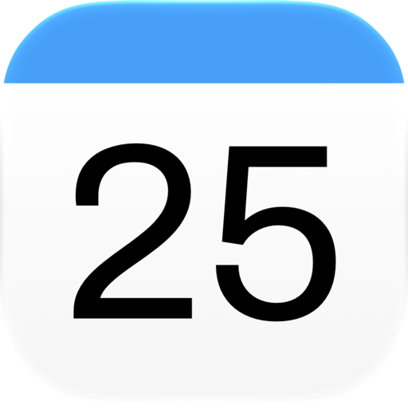
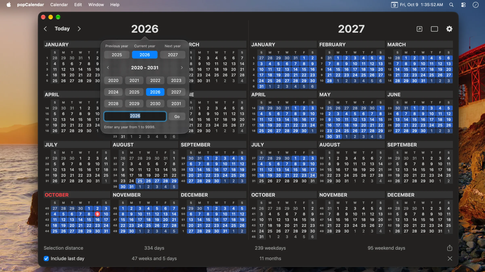

# popCalendar

Your whole year. One click away.

popCalendar is a native Mac menu bar calendar that puts all twelve months within reach. See the bigger picture, count days with a drag, and keep your plans close without opening a separate calculator.

Coming soon to the Mac App Store. Currently in development for macOS 12 Monterey and later, on Apple silicon and Intel Macs.

[Visit the website](https://popcalendar.app/) | [Get support](https://popcalendar.app/support/) | [Open issues](https://github.com/JulyIghor/popCalendar/issues)

## A bigger picture of your time

[See more screenshots](https://popcalendar.app/#gallery) or [watch the app preview](https://popcalendar.app/#preview).

## What you can do

- See a full year in a resizable calendar, available from your menu bar or a custom keyboard shortcut.
- Drag across dates to count days, working days, weekends, and the distance in weeks, months, and years. Adjust either endpoint and choose whether the last day counts.
- Show two years side by side, even when they are not consecutive. Select between them to calculate the complete distance, including the years in between.
- Choose your working weekdays and optionally exclude all-day events from holiday or time-off calendars already on your Mac.
- Save named date ranges, pin a countdown, copy a distance summary, or share an image of your calendar and its selection.
- Preview events, explore a month and its agenda, create and edit events, and organize your calendars into sets for work and personal plans.
- Open independent calendar windows with their own dates, selections, sizes, and calendar sets.
- Put an analog or digital clock behind the calendar, bringing time and dates into the same view. Personalize the menu bar icon, date and time text, and calendar appearance.

Calendar access is optional. Browsing dates and calculating ranges work without it. Showing and editing events, or using holiday and time-off calendars, requires permission. Holiday calendars are not downloaded automatically.

## Privacy and offline use

The app collects no data and contains no advertising or analytics. It runs in the macOS App Sandbox, has no network entitlement, and works offline. Saved ranges and preferences stay on your Mac.

Calendar account syncing is handled separately by macOS. Opening a web calendar or an online meeting link uses your browser and may require an internet connection.

The popCalendar website uses Plausible analytics separately from the app. Read the [privacy policy](https://popcalendar.app/privacy-policy/) and [terms of service](https://popcalendar.app/terms-of-service/) for details.

## Support and feedback

Use this repository's issue tracker for bug reports and feature requests.

- [Browse open issues or report a bug](https://github.com/JulyIghor/popCalendar/issues)
- [Visit the support page](https://popcalendar.app/support/)
- [Email support@apptrust.app](mailto:support@apptrust.app)

When reporting a bug, include your macOS version, popCalendar version, what you expected, what happened, and the steps to reproduce it. GitHub issues are public, so leave out private calendar details and other personal information.

## Why I made it

The original popCalendar was my favorite calendar. After its developer stopped working on it, I kept using it for years. When I started looking for a replacement, nothing felt as comfortable, especially when I wanted the whole year in my menu bar.

So I built a new, independent popCalendar around the way I use a calendar. Counting days and working days became part of selecting dates. A clock could sit behind the calendar instead of beside it. What started as a replacement became a chance to make the calendar I had always wanted.

[Read the story behind popCalendar](https://popcalendar.app/#story).

## About the developer

Made by [Ighor July](https://reverseeverything.com/ighor/).

[Explore more apps by the developer](https://reverseeverything.com/apps/).
