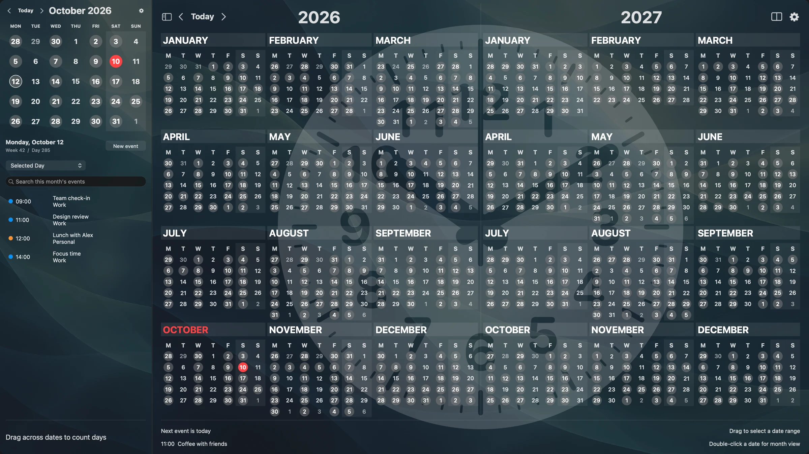
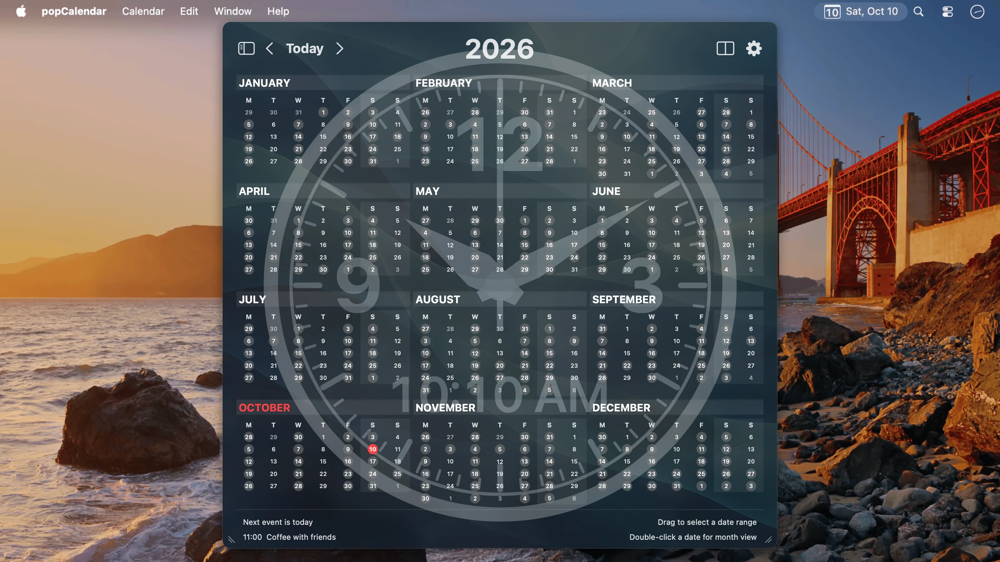
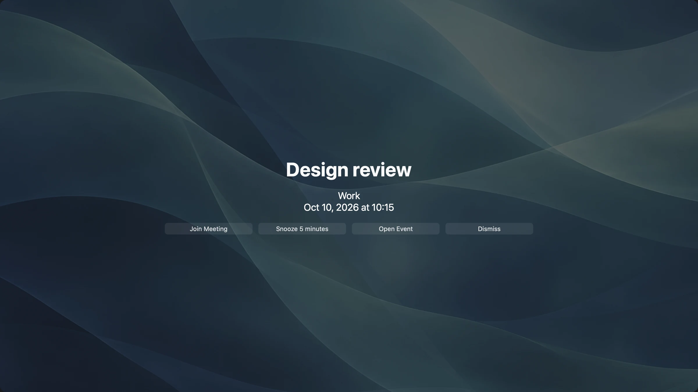

# popCalendar

Your whole year. One click away.

popCalendar is a native Mac calendar with a full year in your menu bar and a live clock behind the calendar. See all twelve months at a glance, count days with a drag, and keep your daily events beside the bigger picture. Stay with a compact popup or give your calendar a whole display.

Available now on the Mac App Store for macOS 12 Monterey and later, on Apple silicon and Intel Macs.

[Get popCalendar on the Mac App Store](https://apps.apple.com/app/apple-store/id6791947576?pt=127627850&ct=www&mt=8) | [Visit the website](https://popcalendar.app/) | [Get support](https://popcalendar.app/support/)

Two years, a month sidebar, and the selected day's events in one fullscreen view.

[Watch popCalendar in action](https://popcalendar.app/#preview) or [explore more screenshots](https://popcalendar.app/#gallery).

## A full year in your menu bar

Open the whole year with one click or a custom keyboard shortcut. Click outside the popup to return to what you were doing.

Choose one or two months, one or two years, or a month sidebar beside one or two years. Click a date in the year view to see that day's events in the sidebar without losing the overview.

Independent calendar windows remember their layouts, dates, selections, sizes, and positions across restarts. The menu bar popup remembers its size for each display. You can also hide the menu bar icon and use windows and the Dock.

## A clock behind the calendar

Bring time and dates into the same view with 27 analog, digital, and hybrid clock presets. Customize the clock's appearance, size, and opacity, with sweeping, ticking, bouncing, or hidden seconds.

Use your own photo, one of six abstract backgrounds, or random images from a chosen folder. Add today's date or personal text, and adjust calendar text sizes, event colors, and weekend shading to suit the view.

## Count time by selecting it

- Drag across dates to count days, working days, weekends, weeks, months, and years. Adjust either endpoint and choose whether the last day counts.
- Select across two years, even nonconsecutive ones. The calculation includes the years in between.
- See event counts, total duration, occupied time with overlaps counted once, and distinct start times alongside the date distance.
- Save named ranges, choose outline colors, and pin countdowns. Ranges shorter than a year can repeat annually. Copy a summary or export a calendar screenshot.
- Choose your working weekdays and optionally exclude all-day events from holiday or time-off calendars already on your Mac. Holiday calendars are not downloaded automatically.

## Events and reminders

Browse the selected day, today, tomorrow, or the next seven days. Search, preview, create, edit, duplicate, or delete events when permitted. Switch saved Calendar Sets to separate work and personal plans. Quick entry in your interface language or English fills an event draft for you to review.

Enable optional notifications for events and saved date ranges. Fullscreen meeting reminders offer Join Meeting, Snooze, Open Event, and Dismiss actions, with adjustable size, display, background, opacity, and animation. Fullscreen reminders require popCalendar to be running. System notifications require macOS permission.

The interface is available in English, Ukrainian, German, Spanish, and Portuguese, including Latin American Spanish and Brazilian and European Portuguese. Follow the macOS language or choose one in Settings.

## Privacy and offline use

popCalendar runs in the macOS App Sandbox and has no advertising, developer analytics, or developer-operated accounts. The developer does not collect personal data, usage statistics, or calendar information. Preferences, saved ranges, Calendar Sets, and background images stay on your Mac.

Date browsing, calculations, backgrounds, and quick entry work offline. Calendar access is optional and uses calendars already configured on your Mac. macOS handles calendar account syncing separately.

Apple Maps location suggestions send your search text directly to Apple and require an internet connection. Manual locations work offline. Opening online meeting links or web calendars may also require internet access.

The popCalendar website uses Plausible analytics separately from the app. Read the [privacy policy](https://popcalendar.app/privacy-policy/) and [terms of service](https://popcalendar.app/terms-of-service/) for details.

## The story behind popCalendar

One small menu bar calendar became the way I understood dates. When the original popCalendar disappeared from the Mac App Store and its future became uncertain, finding a replacement turned out to be harder than I expected.

In [How I Finally Started Using a Calendar](https://reverseeverything.com/blog/the-mac-calendar-i-couldnt-let-disappear/), I share how that everyday habit led me to build a new, independent popCalendar, and how it grew beyond the app I first set out to replace.

## Support and feedback

This repository is the public home for popCalendar's overview, bug reports, and feature requests. The app is distributed through the Mac App Store.

- [Browse open issues or report a bug](https://github.com/JulyIghor/popCalendar/issues)
- [Visit the support page](https://popcalendar.app/support/)
- [Email support@apptrust.app](mailto:support@apptrust.app)

When reporting a bug, include your macOS version, popCalendar version, what you expected, what happened, and the steps to reproduce it. GitHub issues are public, so leave out private calendar details and other personal information.

## About the developer

Made by [Ighor July](https://reverseeverything.com/ighor/).

[Explore more apps by the developer](https://reverseeverything.com/apps/).
